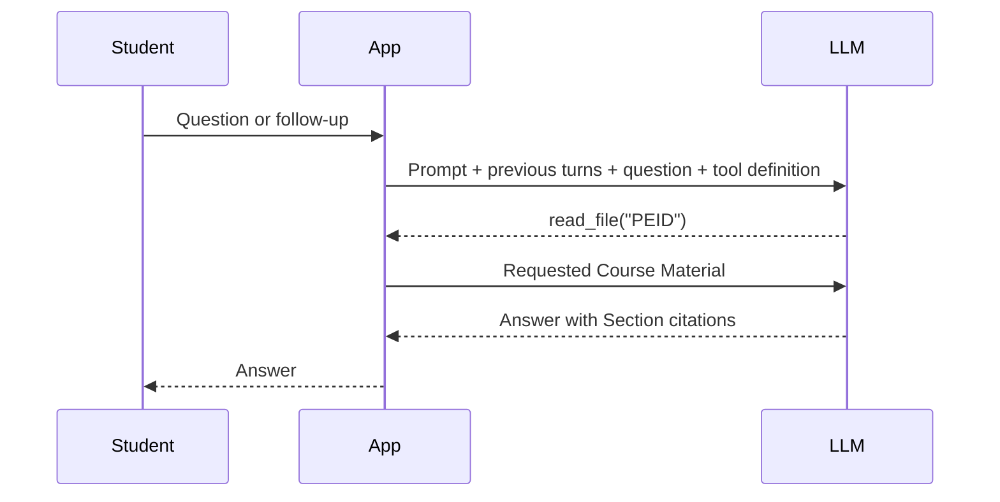

# Agentic Tutor workflow

The Agentic Tutor has one model, one repeatable `read_file(course)` tool and a plain Python loop.

## The usual path

A typical question takes two LLM calls and one Read. The LLM chooses the Course; Python validates the request and
returns the whole Course Material. If the model needs another Course, the same loop runs again. A reply without
tool calls ends the loop after a Read, or immediately for the exact Out of scope Sentence. A different reply without
a Read gets one scope-aware recovery attempt.

## Where to read the code

| Responsibility | Location |
| --- | --- |
| Keep and display the conversation | `src/app.py` |
| Run the model/Read loop | `run_agentic()` in `src/agentic.py` |
| Validate a Course code and return its material | `_read()` in `src/agentic.py` |
| Build the shared result and check the answer | `_answer_agentic()` in `src/tutor.py` |
| Send the actual provider request | `OpenAIChatModel.chat()` in `src/llm.py` |

`answer_question(..., tutor="agentic", history=...)` remains the entry point used by the screen and evaluator.
The dedicated module returns an `AgenticRun`: final text, Read records, limit status and any model-call error.
It does not decide whether citations, Refusals or evaluation Steps pass.

## Chat context

Previous user messages and assistant answers are sent between the system prompt and the latest question. Previous
Course Material and tool calls are not retained across questions. Each answer reads its own material; previous
answers provide conversational context, not evidence for new claims. **New conversation** clears the chat.

## Limits and errors

- The tool accepts only `GAIF`, `PEID`, `AITB` and `DTGS`. Invalid arguments return `Unknown Course.` and count as Reads.
- At most four Reads are executed per question. After the fourth, one final LLM call has tools disabled.
- Several tool calls in one reply are supported. Calls beyond the limit receive `Read limit reached.` without reading.
- Each tool result carries the ID of its matching assistant tool call, as required by the provider protocol.
- A failed model call returns an error with the Read records collected so far; the screen offers a retry.
- The model gives the exact Out of scope Sentence without a Read for requests outside the tutor's purpose,
  including identity requests and greetings without a Course question. Both screens show the shared purpose notice.
- A different reply without a Read gets one recovery attempt: reconsider the original request and conversation,
  return the Out of scope Sentence if appropriate, or read the relevant Course Material before answering.
- If recovery again returns a noncanonical reply with no Read, the result is an error. The screen shows the retry
  notice and excludes the failed exchange from successful history. Absence of a Read alone never means Out of scope.

## Evaluation is separate

`tutor.py` maps the execution records into the existing `TutorResult`, identifies the exact Refusal or Out of scope
sentence and checks citations against Sections of material read during this answer. `scoring.py` then grades Search,
Path and Answer. Repeated Reads and reaching the Read limit remain Path Step failures.

The evaluator supplies no chat history. Existing single-message scores do not measure follow-up answer quality.
The purpose-boundary candidate uses `agentic_tutor_v2` and scope-aware recovery. Its live-model classification,
contextual follow-ups and Golden Set results are pending ticket #25; deterministic fake-model tests verify handling
of the scripted outcomes. Earlier scores remain measurements of earlier versions, as recorded in the iteration log.
